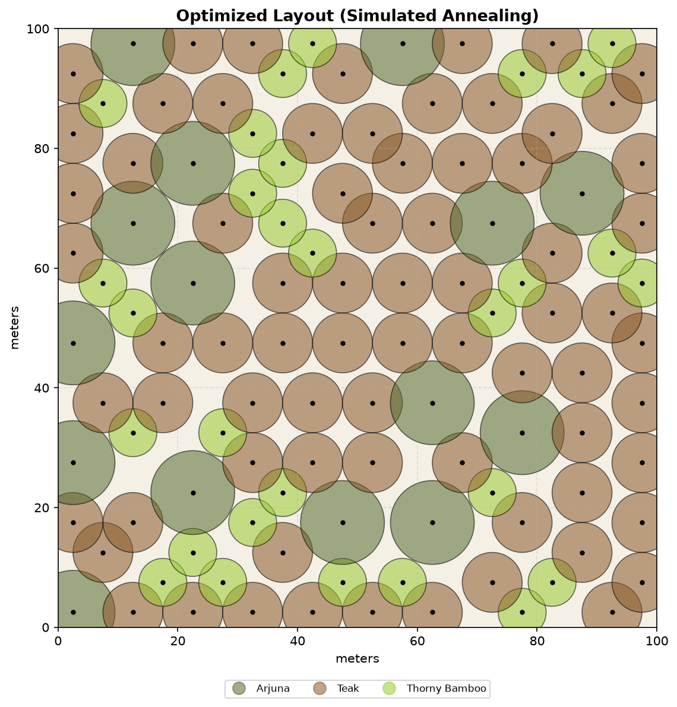

# Algorithmic Reforestation Planner

Optimizes where to plant which tree species on a plot of land to maximize
carbon capture and biodiversity, using simulated annealing constrained by
real canopy-spacing physics — instead of naive uniform monoculture planting.

## Result

On a 40m x 40m sample plot (Plot near Harihar, Karnataka):

| Strategy | Trees Planted | Species Diversity | 20yr Carbon Capture |
|---|---|---|---|
| Naive monoculture baseline (spacing-respecting) | 16 | 1 | 11,200 kg |
| **Optimized (simulated annealing)** | 117 | 3 | **43,521 kg (+288.6%)** |



## Why this isn't just "plant more trees"

A naive approach often picks the single highest-carbon species and packs it
in on a fixed grid, ignoring the fact that a mature tree's canopy needs
room — otherwise trees compete for light and choke each other out. This
project treats each tree as a circle (canopy radius) and only accepts
placements that respect real spacing physics, then uses simulated annealing
to search for the species + placement combination that maximizes carbon
capture and biodiversity within that constraint.

## How it works

1. **Data ingestion** (`src/fetch_data.py`) — pulls real soil pH (SoilGrids),
   solar radiation/rainfall (NASA POWER), and elevation (Open-Elevation) for
   a chosen plot, all from free, no-signup APIs.
2. **Suitability scoring** (`src/suitability.py`) — scores how well each of
   8 species matches the plot's actual soil/rainfall/sunlight conditions.
3. **Grid + spacing model** (`src/grid.py`) — represents the plot as a grid,
   computes canopy-overlap penalties and a biodiversity bonus per cell.
4. **Simulated annealing optimizer** (`src/optimizer.py`) — searches the
   space of possible layouts, accepting worse moves probabilistically
   (cooling schedule) to escape local optima like monoculture blocks.
5. **Carbon + baseline comparison** (`src/carbon.py`) — computes carbon
   capture and compares against a fair, spacing-respecting baseline.
6. **Visualization** (`src/visualize.py`) — renders the layout to scale,
   color-coded by species.

## Interactive Web Platform

The project includes an interactive web platform with a **FastAPI backend** and a **React + Vite + Tailwind CSS frontend** featuring:
- **Interactive Satellite GIS Map**: Select study sites worldwide, inspect real satellite imagery via Leaflet / Esri World Imagery, and view planted tree canopies overlaid directly onto satellite coordinates.
- **Live Annealing Visualization**: Real-time WebSocket streaming of simulated annealing moves, temperature cooling, and tree packing on a high-performance 2D Canvas.
- **Scientific Baseline Scorecard**: Side-by-side comparison against naive monoculture planting (+288% carbon gain benchmark).
- **Shannon-Wiener Biodiversity Index & Canopy Metrics**: Real-time biodiversity entropy and geometric canopy coverage percentage.

### Quick Start (Web Platform)

```bash
# 1. Run the unified platform (FastAPI + React SPA)
npm start
# -> Access at http://localhost:8000

# 2. Or run in hot-reloading development mode:
# Terminal 1:
npm run backend
# Terminal 2:
npm run frontend
# -> Access at http://localhost:5173
```

## Setup (CLI & Legacy Scripts)

```bash
pip install -r requirements.txt
```

## Usage

```bash
# 1. Pull real environmental data for your chosen plot
#    (edit SITE_NAME / LAT_MIN / LON_MIN / etc. in fetch_data.py first)
python3 src/fetch_data.py

# 2. Sanity-check suitability scores for your site
python3 src/suitability.py

# 3. Run the full optimization pipeline + generate visualizations
python3 src/visualize.py
```

Outputs land in `data/`: `optimized_layout.png`, `baseline_layout.png`.

## Species database

8 species commonly used in South Asian reforestation (`data/species_db.json`),
each with soil pH range, rainfall tolerance, sunlight needs, mature canopy
radius, and known carbon sequestration rate (kg CO2/year), curated from
forestry reference data.

## Limitations / future work

- Uses a fixed rectangular plot; a real deployment would take an arbitrary
  land boundary polygon and rasterize it into the grid (point-in-polygon
  test), which this project intentionally scoped out to fit a 2-week build.
- Averages soil/climate samples across the plot rather than interpolating
  per-cell — fine for a small plot, would need spatial interpolation
  (e.g., kriging) for a larger or more heterogeneous one.
- Species database is hand-curated for 8 species; could be extended with a
  proper botanical/forestry dataset.

## Tech

Python, NASA POWER API, SoilGrids (ISRIC) API, Open-Elevation API,
simulated annealing, matplotlib.
